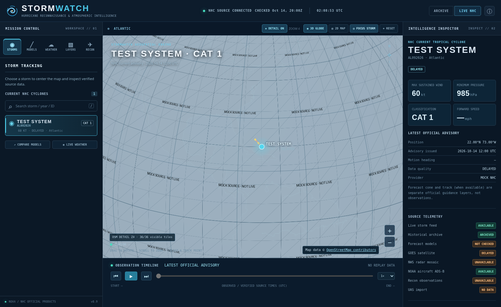
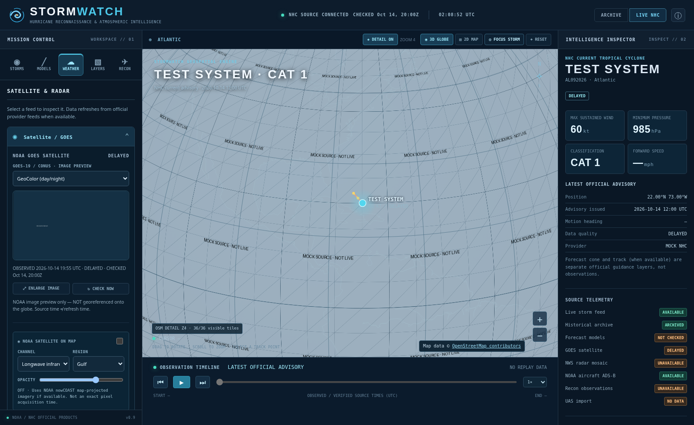
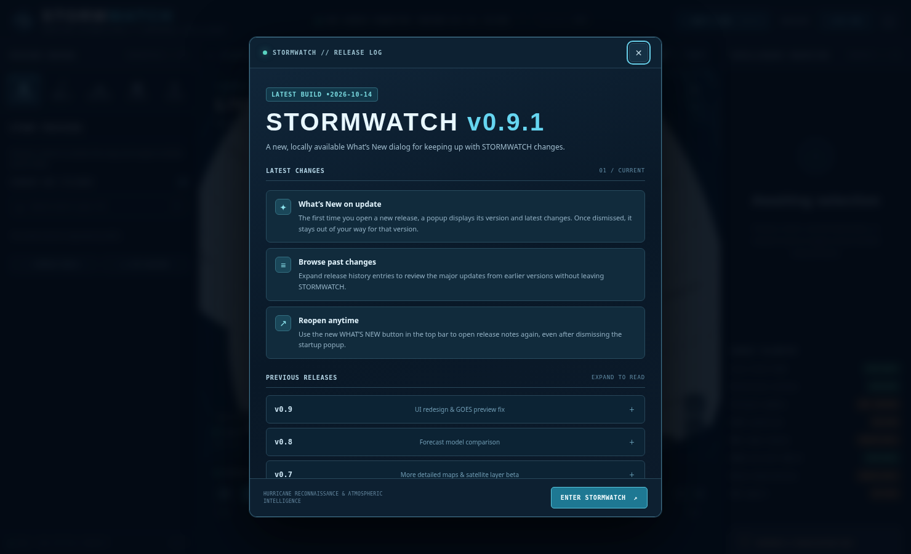

# STORMWATCH
## Hurricane Reconnaissance & Atmospheric Intelligence Platform

**Version 0.9.2 — radar geographical alignment and stale-data safety fix, building on the v0.9.1 release-notes popup.** Runnable research MVP, not a complete implementation of the full project brief.

STORMWATCH is a standalone, Windows-friendly FastAPI dashboard with an offline-capable interactive orthographic globe/2D map. It uses real NOAA/NHC datasets and distinguishes live advisories, forecasts, historical best tracks, archived advisory snapshots, and aircraft recon fixes. It never substitutes simulated storm positions when live sources are unreachable.




*Screenshot: dashboard UI exercised in an isolated Chromium test with fixture-backed/mocked HTTP responses. It is **not** proof of real-time NOAA access.*


*The v0.9.1 screenshot uses a fixture-backed UI test; it is not a live provider result.*

### Start on Windows

**Upgrading from an earlier version?** Stop the old black terminal with **Ctrl+C**, extract the new ZIP and replace the existing `stormwatch` folder/files; you may keep its `.venv` environment folder. Double-click `start-windows.bat` again, then in the browser press **Ctrl+Shift+R**. Make sure the old server is stopped first.

1. Install **Python 3.11 or newer** from https://www.python.org/downloads/ and select **Add Python to PATH**; ensure the Python launcher (`py`) is available.
2. Extract the ZIP to a normal folder, e.g. `C:\STORMWATCH`.
3. Double-click **`start-windows.bat`**. The first run uses `pip` to install Python dependencies into `.venv` and therefore normally requires internet access. No Node.js or API tokens required.
4. Open **http://127.0.0.1:8000** in a modern desktop browser (Chrome, Edge, Firefox). Use Ctrl+C in the terminal to stop the server.
5. To run Python tests from a command prompt: `set PYTHONPATH=%CD%\apps\api` then `.venv\Scripts\python.exe -m pip install pytest pytest-asyncio` then `.venv\Scripts\python.exe -m pytest -q`.

**Docker option:** with Docker Desktop installed, run `docker compose up --build` and open http://127.0.0.1:8000. Docker Compose was supplied but could not be executed in the build environment; no claim of a verified Docker image is made.

**Linux/macOS:** `bash start-linux-macos.sh`.

### Explore the application

- On opening, the app selects **LIVE NHC** by default and refreshes the official NHC active-storm feed every five minutes while the app is open. The FastAPI server also checks for changes on a five-minute schedule and sends update notifications through WebSocket. **An active cyclone appears only if NOAA/NHC provides one.** Switch to **ARCHIVE** to explore Hurricane Milton (2024), a series of **10 real NHC advisory snapshots** with per-advisory links. Use the bottom time slider, play/pause, forward/backward, and speed selector. These are *not* continuous observations and are *not* HURDAT2 best tracks.
- Use the **3D GLOBE** control to rotate the offline orthographic globe with your mouse, and **2D MAP** to switch to an overhead equirectangular view. Wheel to zoom. Geospatial coastline vectors and land boundaries are bundled for offline use.
- Choose **LIVE NHC** to request `CurrentStorms.json`, which includes current active storms, intensities (kt), pressures (hPa), storm centers, and NHC forecast GIS URLs. The map renders current centers when NHC can be reached. Select one to retrieve its official NHC forecast cone and forecast track KMZ (no forecasts are invented).
- The left sidebar **NOAA GOES SATELLITE** panel displays an actual NOAA/NESDIS STAR published **CONUS image preview** when the provider is reachable, with GeoColor, band 13 infrared, and band 8 water vapor choices. It uses the real UTC time encoded in the NOAA image filename, not the refresh time. Images are presented in a separate preview panel **not as a geographically registered overlay**. Click **ENLARGE IMAGE** for a bigger view. Missing/broken imagery is shown as unavailable. The NOAA feed is not guaranteed reachable and is not tested against the live source from this build environment. An experimental, separate NOAA nowCOAST **SATELLITE ON MAP** option is documented below.
- **New v0.5 NWS radar layer:** Check **NWS radar mosaic** under geospatial layers, select **Gulf, Southeast, Caribbean, or CONUS** in the weather radar section, and click **FOCUS REGION**. A NOAA/NWS MRMS image is requested from the official *time-enabled* reflectivity ImageServer and geographically mapped onto both the globe and overhead 2D map. Adjust opacity and select an available time offset (15–120 minutes). Only NWS-served imagery is displayed; the image is never synthetic. **The selected timestamp is the image-service request time, NOT a verified pixel acquisition time.** Coverage is regional, especially limited over open ocean. The color band in the sidebar is indicative; for calibrated dBZ legends open the official NWS radar product. Radar overlays appear **only in LIVE mode**, never while playing historical storms. The client refreshes every five minutes; a service outage is reported as UNAVAILABLE, not silent substitution. This URL needs no API key: https://mapservices.weather.noaa.gov/eventdriven/rest/services/radar/radar_base_reflectivity_time/ImageServer
- **New v0.5 reconnaissance status:** The source-health sidebar now checks the USAF Atlantic NHC HDOB bulletin automatically, reporting the last available verified observation time and the bulletin's age. A months-old bulletin is labeled **ARCHIVED**, not an active mission. Clicking **Latest public HDOB** plots positions from the available published bulletin; v0.6 also includes independent, timestamped ADS-B sightings of the known NOAA aircraft listed below.
- The source status button in the top bar now shows background-poller and source-health information. The top bar distinguishes last **checked** time from advisory and image **observed** times. Clicking **CHECK NOW** next to the satellite panel retrieves metadata again (subject to the five-minute cache).
- Select **HDOB Observation Viewer** for 20 official archived USAF recon HDOB observations dated September 10, 2026. The source is referenced on-screen and this **is not live aircraft tracking**. **Latest public HDOB** tries the current public bulletin.
- Click **Import UAS CSV** to plot up to 5,000 rows of local observations in the current server session. A CSV must contain `time,lat,lon` with ISO 8601 timezone-aware timestamps and decimal degrees, and can optionally include `wind_kt,temperature_c,pressure_hpa,altitude_m,rh_pct`. User-supplied measurements are never certified as official NOAA data.
- In the Milton inspector click **SYNC COMPLETE NHC HURDAT2 TRACKS**. This downloads the version-pinned NHC Atlantic and eastern Pacific datasets (roughly 11 MB combined) while online. The six showcase Atlantic storms in the task brief then become selectable **where records are present**. HURDAT2 tracks are official post-analysis and are distinct from NHC real-time advisories.

### New in v0.9: simplified interface and fixed GOES sizing

- **Critical image fix:** The full-size NOAA GOES-19 image (source raster typically 1250 × 750 px) no longer expands the operations sidebar. The responsive thumbnail is contained within a 5:3 frame with a **200 px maximum height**, and "Enlarge image" opens a separate, viewport-bounded image viewer. The full source image is used without downsampling the fetched asset. The necessary CSS is also embedded directly in the HTML for resilience when an external stylesheet is blocked or cached incorrectly.
- **Five organized workspaces:** use **STORMS** (search/select storms), **MODELS** (ATCF tracks, model toggles, intensity/pressure chart, CSV), **WEATHER** (GOES preview, NOAA projected satellite controls, radar), **LAYERS** (globe overlays), and **RECON** (aircraft ADS-B sightings, public/archived HDOB, UAS CSV). Map, timeline and storm inspector stay visible while switching. Use the sidebar tabs or the shortcuts below a selected storm. The left sidebar scrolls separately from the globe.
- **Collapsible feeds:** the Weather panel defaults to satellite details open and radar details closed. Expand whichever is useful. Hurricane Hunters details are grouped under Recon. Tab panels stay mounted, so cached telemetry and background refresh remain available.
- **Focus selected storm:** the map toolbar now has a **FOCUS STORM** button that recenters on the selected live storm or selected archived observation. Map pan/zoom and detailed city/road basemap still work as before.
- **Keyboard access:** when a sidebar tab has focus, use Left/Right arrows or Home/End to change workspaces. All sidebar controls retain their original IDs and API routes.
- **Historical mode:** MODELS and WEATHER tabs are hidden entirely in ARCHIVE (as requested). The RECON workspace still exposes historical HDOB and UAS tools, but hides live aircraft sightings and the latest live bulletin button. Storm replay and map detail remain usable.
- **Unchanged live-source limitations:** v0.9 reorganizes and repairs the frontend; it does not add new model feeds or verify that NHC, GOES, radar, OSM, ADS-B or Google/ECMWF guidance are reachable on your PC. It still requires a network connection for live provider products.

**How to use the new dashboard:** Open **STORMS** and select a current cyclone, then **MODELS** to compare tracks/intensity or **WEATHER** for GOES/radar. Select **ARCHIVE** at top right to replay archived storms without showing contemporary satellite/radar panels. For full images click **ENLARGE IMAGE** (the small preview stays inside the sidebar).

### New in v0.8: track + intensity model comparison (live storms only)

1. Select **LIVE NHC**, then click any storm returned by the official NHC `CurrentStorms.json` service. STORMWATCH requests `https://ftp.nhc.noaa.gov/atcf/aid_public/a<stormid>.dat.gz` on a 5-minute cache (e.g., `aal092026.dat.gz`). **The server cannot manufacture an active cyclone or model forecast.** If the storm list is empty, offline, or inaccessible, no live model tracks are shown.
2. Under **FORECAST MODEL COMPARISON**, choose a UTC initialization cycle. Different models are displayed **only when the same initialization cycle is present**, avoiding scientifically misleading older-model comparisons. Select individual model checkboxes to draw geographically positioned tracks on the globe or 2D map. Physics-based tracks are solid; AI tracks dashed. Clicking a 24-hour model marker shows predicted valid time, position, wind and pressure when available.
3. The right inspector charts **maximum sustained wind (kt)** or **minimum central pressure (hPa)** against forecast lead time using actual ATCF values. Missing pressure/wind stays missing, without interpolating nonexistent measurements. Choose **↓ CSV** to export the real A-deck forecast points (including model aid ID, cycle UTC, valid time UTC, lead hours, coordinates, intensity and pressure).
4. Model catalog: official NHC forecast `OFCL/OFCI` (when present), HAFS-A `HFSA`, HAFS-B `HFSB`, GFS `AVNO/AVNI/GFSO/GFSI`, ECMWF IFS `EMXI`, Google DeepMind `GDMI/GDMN`, GenCast `GENI/GENC`, NOAA AI-GFS `GAIO/GAII`, AI-GEFS `EGMN/EGMI`, ECMWF AIFS `EAIO/EAII/EAMN/EAMI`. Aliases are searched **within the public A-deck only**; model labels are marked **NOT IN PUBLIC DECK** if unavailable, restricted, or absent for that forecast cycle. The model catalog is not a promise that all providers' real-time predictions can be retrieved.
5. **HAFS-A and HAFS-B are physics-based models, not HAFS-AI.** A separately requested **HAFS-AI** item is included as **NO VERIFIED HAFS-AI FEED**. We did not verify an authoritative public ATCF code / direct model feed for that exact name; no forecasts are misattributed to it.
6. Google DeepMind's experimental WeatherNext Cyclones forecasts can be explored at https://deepmind.google.com/science/weatherlab . Experimental research guidance **is not an official NHC forecast**. ECMWF's open IFS and AIFS tropical-cyclone track products are distributed primarily as BUFR; direct ECMWF BUFR ingestion is **not implemented** in v0.8. Some ECMWF aids have public-access restrictions. These appear as unavailable when missing from NHC's public A-deck.
7. No new API keys or paid services are required for the NHC ATCF connector. NHC public access, model distribution, and permissions can change. Model forecast availability and freshness are checked separately from server health, and the model panel disappears completely in **ARCHIVE** mode along with live radar/satellite options.

**Models are objective forecast guidance, not observations.** Consult official https://www.nhc.noaa.gov/ products for hazards. Do not compare different cycle times or treat one individual experimental model as an official warning. The v0.8 upstream connector and public feed availability were not verifiable in the build environment due to disabled external DNS; functionality was exercised with mocked official-shaped ATCF fixtures.

### New in v0.6: public aircraft sightings and archive mode

- In **LIVE NHC** mode, **HURRICANE HUNTERS · ADS-B** shows public positions reported for NOAA aircraft **N42RF (Kermit), N43RF (Miss Piggy), and N49RF (Gonzo)**. These are verified identities for the registrations, but an ADS-B sighting **does not confirm that the airframe is flying a tropical-cyclone reconnaissance mission**. When no recent position exists, the list explicitly says so and does **not** claim the airplane is grounded.
- ADS-B data is requested from https://api.adsb.lol/v2/reg/N42RF,N43RF,N49RF . The API is public, currently without an API key for educational use, and subject to its availability, rate limits, ODbL license and provider terms; contact the provider before commercial/production use. The server polls at approximately five-minute intervals and caches requests. It shows only positions received within 10 minutes, marks positions LIVE only when 90 seconds old or less (or DELAYED up to 10 minutes), and preserves the provider's recorded observation timestamp. Old, missing, malformed, or unreachable data is not interpolated or fabricated.
- Optionally type an **exact TEAL callsign** (e.g. `TEAL21`) to check for a candidate USAF observation. Even a matching TEAL callsign **does not verify the individual aircraft identity, storm association, tasking, or flight plan**. USAF callsigns may vary; this is a manual search, not an all-USAF fleet locator.
- **Archive mode now removes the GOES satellite viewer, NWS radar controls and toggle, NOAA aircraft panel, and live HDOB action from the interface completely**. The NHC forecast-cone toggle also disappears because it only pertains to current forecasts. When returning to LIVE NHC, those controls return. Historical storm replay and available archived recon observations remain supported.
- Aircraft sightings are single individual positions only; **no aircraft flight history, reconstructed trails, mission plans or live routes** are implied.

### New in v0.7: detailed map and optional NOAA satellite overlay

- **High-resolution street and settlement detail in both modes.** The **◈ DETAIL ON** button in the map toolbar overlays **OpenStreetMap raster tiles** onto the existing orthographic globe or 2D map. At wider views the map shows coastlines, countries and large cities; zooming farther reveals regional roads, towns and smaller place names from the tile server. Rendering uses the same world coordinates as NHC storm markers, with a Web Mercator-to-map projection mesh; it requests only currently visible tiles, up to 36 concurrently displayed and at most three active HTTP image loads at a time. A normal desktop browser cache is used. **No OpenStreetMap tiles are stored or shipped with the ZIP, and bulk/offline tile downloading is not supported.** The OSM map requires internet and may be best-effort/unavailable. The bundled coarse coastline/land map is always available offline and via the DETAIL OFF toggle. OSM copyright attribution remains visible when the tiled map is enabled. This is an image-tile map, not CesiumJS terrain or 3D buildings.
- **More zoom range:** use the mouse wheel or + / − to zoom from basin scale into towns and local roads; native tile zoom increases to preserve geographic detail. The status strip reports tile zoom level and how many visible tiles are loaded. Browser/device performance varies, especially while projecting tiles around the 3D globe. Keyboard arrows support panning as before.
- **NOAA satellite mapped to the globe (experimental):** In **LIVE NHC**, enable **NOAA SATELLITE ON MAP**, select a region and infrared, visible, or water-vapor channel, and adjust opacity. The FastAPI backend first asks NOAA's **nowCOAST ArcGIS MapServer** for its advertised layer names, then requests that exact layer reprojected in EPSG:4326; no static NOAA STAR JPEG is stretched onto a map. The bounded, same-origin image request is meshed onto the globe/2D map. A geographic image export is not proof of exact pixel acquisition times: **the app labels these times unverified**. Upstream NOAA nowCOAST access could not be exercised in this environment (some test access returned HTTP 403), so this is a beta connector, **not a claimed fully working live satellite overlay**. If it is inaccessible, the map and existing satellite preview remain usable. In ARCHIVE the entire satellite overlay control disappears and no modern imagery is painted over historical storms.
- NOAA nowCOAST GIS service: https://nowcoast.noaa.gov/arcgis/rest/services/nowcoast/sat_meteo_imagery_time/MapServer . Public map tile endpoint: https://tile.openstreetmap.org/{z}/{x}/{y}.png . OSM requires visible attribution, proper browser Referrer and browser cache, and forbids bulk tiles/offline downloads; see https://operations.osmfoundation.org/policies/tiles/ . For intensive or commercial deployment, use a dedicated tile provider or self-host.
- **No new paid API key required**, but interactive detailed maps require that your Windows browser can access `tile.openstreetmap.org`; the nowCOAST overlay is subject to NOAA service availability.

### Scientific provenance, timing and availability

- **No fake live points.** If NOAA is unreachable, live results are *unavailable* or explicitly *stale cached responses*, not "no active storms". The archived fixture remains available.
- Historic Milton points come from specific NHC advisories. NHC advisory wind speeds in mph are converted to knots using 1 kt = 1.150779448 mph; displayed converted kt values are derived, not verbatim reported knots.
- HURDAT2 values preserve NOAA/NHC observed times, kt wind, and hPa pressure, with `-999` represented as null.
- HDOB position, time, and winds use a deliberately conservative subset of the official format. Altitude, pressure, and other HDOB fields that have not been fully decoded remain null. The observation time is based on the header date plus HHMMSS with midnight rollover handling.
- All API timestamp strings are timezone-aware UTC ISO 8601. Present UTC quality labels represent the age of each observation (not the last webpage refresh).
- `LIVE`: up to 90 min old. `DELAYED`: up to 6h. `STALE`: older than 6h. `ARCHIVED`: historical records. `UNAVAILABLE`: fetch failure or missing observation. These boundaries are **STORMWATCH interface thresholds**, not NHC operational categories.
- Current advisory forecast overlays from NHC GIS are explicitly forecasts, never observations.
- `CurrentStorms.json` fields `intensity` and `movementSpeed` are displayed as **kt** and **mph** respectively.

### Automatic live updates

- On startup the backend starts a **five-minute** scheduled poll of NOAA/NHC `CurrentStorms.json`, NOAA GOES-19 CONUS GeoColor metadata, NWS radar time-window metadata, the latest public USAF Atlantic HDOB bulletin, and public NOAA-aircraft ADS-B sightings. The backend uses an HTTPS host allowlist, size limits, caching, bounded timeouts, and source-specific error states. Browser clients refresh the data when a source-change event is received, every five minutes as a fallback, and when returning to the browser tab.
- Automatic refresh means *checking for new official NOAA products*, **not** fabricating new observations or aircraft locations. NHC advisory times and satellite acquisition times are provided independently from UTC check times. Source data is only shown when available; explicitly stale cached NHC values are marked **STALE**.
- Optional environment variables: `STORMWATCH_POLL_SECONDS=300` (bounded 120–1800 seconds) and `STORMWATCH_BACKGROUND_POLL=0` to disable server background polling (e.g., offline test). The client still fetches its own data. No API key required.
- Satellite images are loaded from NOAA’s CDN by the user’s browser; browsers or firewalls that block that domain may show **IMAGE FAILED** even when the metadata source is reachable. Satellite data is experimental/informational as noted by NOAA STAR and not suitable as a safety-critical decision source.

### API endpoints

See interactive OpenAPI at **http://127.0.0.1:8000/docs**. Main endpoints:

| Endpoint | Description |
|---|---|
| `GET /api/health` | Server health, background polling times, and source status |
| `GET /api/aircraft/noaa` | Public NOAA N42RF/N43RF/N49RF ADS-B sightings or explicit unavailable; never verified mission status |
| `GET /api/aircraft/teal?callsign=TEAL21` | Optional exact USAF TEAL callsign search; aircraft identity and mission unverified |
| `GET /api/radar/status` | NOAA/NWS MRMS radar availability, provider time coverage and regions; unavailable if offline |
| `GET /api/radar/image?region=gulf&minutes_ago=0` | Proxies a bounded official radar PNG; returns HTTP 503 on provider failure; selected service time is *requested*, not independently observed |
| `GET /api/recon/status` | Latest accessible USAF Atlantic HDOB timestamp/quality or explicit unavailable state |
| `GET /api/satellite/latest?channel=GEOCOLOR` | Official GOES-19 CONUS preview metadata; also `IR` and `WATER_VAPOR` |
| `GET /api/storms/live` | Latest officially reported active NHC storms, or explicit provider failure/stale-cache indicator |
| `GET /api/storms/{id}/forecast` | NHC official cone and track from on-demand KMZ conversion |
| `GET /api/storms/historical` | Available offline historical fixture and any synchronized HURDAT2 tracks |
| `GET /api/storms/historical?sync=true` | Try downloading & parsing pinned NOAA/NHC HURDAT2 datasets |
| `GET /api/storms/historical/{id}` | Full historic track, source and timestamps |
| `GET /api/recon/fixture` | 20 historic HDOB rows from an actual NHC product |
| `GET /api/recon/latest?provider_name=USAF%20Atlantic` | Current publicly posted HDOB product, where obtainable |
| `POST /api/uas/upload` | Upload ≤1 MB CSV; validate and return latest user data |
| `GET /api/uas/latest` | Last UAS CSV imported in current server process |
| `WS /ws` | Source-change events and server heartbeat; neither is a NOAA observation stream |

### Development, design and tested capabilities

- **Core server:** Python FastAPI with `httpx` and bounded source downloads, HTML parsing via BeautifulSoup, KMZ extraction, async endpoints, versioned source URLs, five-minute live-source cache, and graceful provider failures.
- **Client:** dependency-free JS/HTML/CSS for direct local launch; SVG-independent vector coastline data and Canvas 2D orthographic globe with real geographic coordinates; 2D map; controls, storm inspector, provenance, timeline, chart, and overlays.
- **Automated Python tests:** 81 passing in the delivery environment (detailed in `docs/TEST_REPORT.md`). An isolated Chromium UI exercise with mocked NOAA data checked the inline dashboard styles, radar region/time/opacity controls, live-storm inspector, satellite preview/enlarge, historical replay, 2D view, and zero JS page errors. The browser was blocked from opening the local HTTP server by its admin policy; thus the Chromium exercise does **not** establish real browser/server integration.
- **No Node install required for MVP.** Although the larger brief suggests React, TypeScript, Vite and CesiumJS, **this delivered MVP uses a custom interactive Canvas globe and vanilla JavaScript, not that frontend stack**. The offline globe rotates but has no terrain, no 3D buildings, and no true Cesium scene. This is a deliberate reduction to achieve a locally runnable deliverable without npm/network access.
- **No database/Redis at MVP.** NHC fetches and user uploads are kept in the server's volatile process memory and are cleared on restart. HURDAT2 is re-fetched as needed. No authentication or multi-tenant storage.

### What is not yet implemented

- Full CesiumJS 3D scene, real terrain and buildings; Vite/React/TypeScript and production front-end bundling.
- Verified USAF fleet aircraft identity and active mission associations; the implemented public ADS-B lookups show limited recent sightings, not authenticated flight histories or mission status.
- Dropsonde profile decoding, VDM, full HDOB meteorological decode, UAS NetCDF imports, ocean flux calculations, UAS/recon comparisons.
- Fully production-verified NOAA nowCOAST georeferenced imagery: v0.7 implements an optional NOAA EPSG:4326 overlay adapter, but external NOAA nowCOAST service reachability and current layer names have **not** been independently verified here; on failure it stays UNAVAILABLE. Satellite/radar timeline animations and archival imagery remain incomplete.
- HAFS/GFS/ECMWF forecast models, model verification, and ensemble plots.
- Tropical Cyclone Plan of the Day parsing, watches/warnings/wind radii, live radar/rainfall layers.
- Persistent PostGIS, production observability, auth, deployment hardening, load/performance verification.

The delivered build is an **MVP and research/education tool**, **not** a complete production hurricane intelligence system. All hazardous weather decisions must refer to https://www.nhc.noaa.gov/ and https://www.weather.gov/ .

### Troubleshooting

| Symptom | Solution |
|---|---|
| `py` missing | Install Python 3.11+ with the launcher or run `python -m venv .venv`, then use the manual commands below |
| `pip` cannot download dependencies | Connect to the internet to complete the first-time Python install; then `.venv` can be reused |
| `Address already in use` | Stop the other program on port 8000 or launch on another port using `python -m uvicorn stormwatch.main:app --port 8010` |
| NHC feed unavailable | Check your network/firewall; app shows an explicit error and offline Milton demo remains available |
| HURDAT sync fails | NHC domain unreachable or versioned file has changed; check `docs/DATA_PROVIDERS.md` and NHC archive directory |
| Browser shows an old state | Press **Ctrl+Shift+R** for a full reload; stop the old server before replacing files; live data is cached 5 min server-side |
| Satellite is missing / IMAGE FAILED | Confirm your computer can reach `www.star.nesdis.noaa.gov` and `cdn.star.nesdis.noaa.gov`. If NOAA is late or down, the feature remains UNAVAILABLE/STALE; no images are fabricated |
| HURDAT2 dataset appears missing | Click "Sync complete NHC HURDAT2 tracks" with internet access; only the Milton advisory fixture is embedded |

Manual launch from the root folder in PowerShell (when packages are installed):

```powershell
$env:PYTHONPATH = "$PWD\apps\api"
.\.venv\Scripts\python.exe -m uvicorn stormwatch.main:app --host 127.0.0.1 --port 8000
```

### Trust and access

This project is unaffiliated with NOAA, NHC or the U.S. Air Force. Source products are cited by URL. Treat public aircraft recon messages as **published historical observations**; they are not guarantees of real-time aircraft location or mission status. Contact the source agencies for licensing, attribution and operational-use requirements before public redistribution.

### v0.5 notes and caveats

Radar imagery is an NWS MRMS composite, not a storm-wide offshore satellite radar. The actual set of radar sites and the map extent control coverage. Image data are selected by an official `ImageServer` UTC service-window time query; **no per-pixel acquisition timestamp is returned or claimed**. The browser uses a geographically registered EPSG:4326 image and piecewise reprojection into the current map projection; it is NOT 3D volumetric reflectivity. If the official export service rejects image queries, the overlay will be unavailable with a visible error. NOAA weather feeds were researched publicly but could not be exercised from this build environment's container, so confirm against live NWS on your own Windows computer.

**No paid API keys needed** for included NOAA/NHC/NWS adapters. The app now has a public NOAA aircraft ADS-B sightings adapter, but still lacks certified active mission identification, full USAF fleet tracking, aligned GOES cloud imagery over the globe, 3D volumetric radar, and numerical guidance. The scope remains a research MVP, not an operational warning authority.

## v0.9.2 — Radar alignment and fresh-data safety

**Important upgrade recommended for all previous builds.** The older NWS radar overlay was capable of showing echoes in the WRONG geographic location. ArcGIS `exportImage` defaults `adjustAspectRatio=true` and can silently enlarge the request bounds to fit a fixed pixel aspect ratio. STORMWATCH v0.5–v0.9.1 requested all regions as 720×480 but rendered them against the originally requested bounds. v0.9.2 explicitly sets `adjustAspectRatio=false` AND makes the raster output aspect match each region's EPSG:4326 bounding box. Both safeguards ensure image pixels correspond to the geographic mesh in the 2D and 3D map.

The live Weather radar panel now hides the layer if the NOAA radar service window is classified `STALE` (more than 30 minutes since the provider's latest published time window end), and clears the old image while checking for updates. It clarifies that **radar echoes are not confirmed rain on the ground**: clutter, virga, and different products/filters in phone apps can produce apparent differences. A provider window boundary is NOT an independently verified scan acquisition timestamp. Compare with https://radar.weather.gov/ if the map and local observations disagree. Some NOAA outages may cause the layer to be hidden.

This patch corrects the request geometry based on Esri's documented export behavior; **a real NOAA service response and Windows map alignment still need to be independently checked**. The rest of the app is unchanged. See `docs/CHANGELOG_v0.9.2.md`.

## v0.9.1 — Version and changelog popup

The first time you launch each STORMWATCH version in a browser, a **What's New** popup shows the currently installed version, its changes, and expandable release history. Dismissing it records the version in that browser's local storage, so it will not appear on each page refresh. You can reopen it at any time using the **WHAT'S NEW v0.9.1** button in the header.

The popup works without NOAA connectivity and needs no API key. If your browser clears or restricts local storage, it may open on each visit. Release history is packaged locally and is not an internet-based software updater. See `docs/CHANGELOG_v0.9.1.md`.
